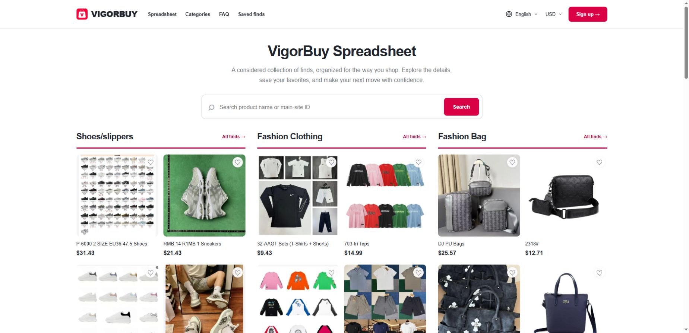

# Pages migration verification — 2026-11-19

All eight sites use the native GitHub connection to `bretosparvinyf788-lgtm/seo-sites2`, branch `main`, in Cloudflare account `957cff16ad6c8cfb15c078cded9ac3dc`.

| Site | Production deployment | Uses Pages Functions | HTTP checks | Mobile menu/layout |
| --- | --- | --- | --- | --- |
| [vigorbuysheetdesk.com](https://vigorbuysheetdesk.com/) | Success | No | 9/9 | Passed |
| [orientdigsheetdesk.com](https://orientdigsheetdesk.com/) | Success | No | 10/10 | Passed |
| [cssbuyfindshub.com](https://cssbuyfindshub.com/) | Success | No | 10/10 | Passed |
| [kakobuysheetdesk.com](https://kakobuysheetdesk.com/) | Success | No | 10/10 | Passed |
| [lovegobuysheetlab.com](https://lovegobuysheetlab.com/) | Success | No | 10/10 | Passed |
| [oopbuyqcguide.com](https://oopbuyqcguide.com/) | Success | No | 10/10 | Passed |
| [sugargoosheetdesk.com](https://sugargoosheetdesk.com/) | Success | No | 10/10 | Passed |
| [superbuyfindsdesk.com](https://superbuyfindsdesk.com/) | Success | No | 10/10 | Passed |

Checks covered home, category, product detail, available guide routes, robots.txt, sitemap index, English/German sitemaps, and a real 404. Each site exports all 4,566 catalogue products and 24 language sitemap files. Core pages and browser catalogue requests work without a Pages Functions allowance.

Browser checks included product and QC images, matching product/referral URLs, German labels, indicative EUR conversion, catalogue search/sorting, and mobile navigation at a 390px viewport. OrientDig image search was tested by pasting a product photo: it returned three matches, with the matching item 4481 first; opening it reached the correct detail and purchase URL.

## Source data limits

The published catalogue is a reference snapshot. Eleven main-site records have an empty or invalid marketplace ID: 2978, 2550, 2540, 2507, 2065, 1842, 1636, 1401, 1380, 1318, and 1072. Their details remain viewable and do not generate a purchase URL with a fabricated ID. Where a seller gallery cannot be read, the matching catalogue reference image remains visible with an availability notice. Source QC stays separate from seller galleries.

For a later catalogue refresh, run `python scripts/sync-catalog.py`, review `common/catalogue.json`, and commit the updated data. The script retains existing seller galleries and curated names. The native Pages integration deploys affected sites from the repository.

